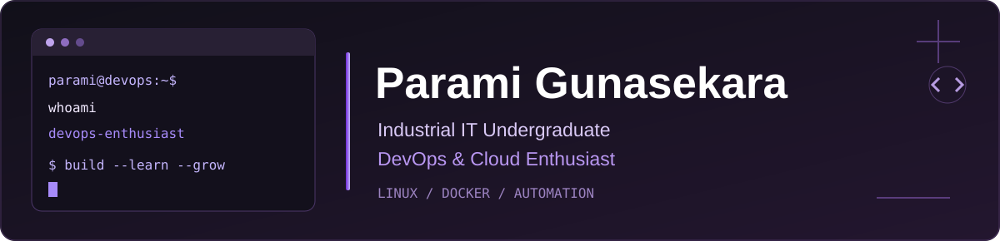

 

  

---

## About Me

I'm **Parami Gunasekara**, an **Industrial Information Technology undergraduate** at **Uva Wellassa University of Sri Lanka**, passionate about DevOps engineering, cloud infrastructure, and automation.

I enjoy understanding how applications move from development to production, working with Linux environments, and building practical projects that strengthen my technical skills.

- 🎓 **Education:** Industrial Information Technology | Expected Graduation: 2027
- 💻 **Hands-on practice:** Linux administration, Bash scripting, Git, and GitHub
- 🐳 **Exploring:** Docker, containerization, and multi-service applications
- ⚙️ **Interested in:** CI/CD, cloud technologies, and infrastructure automation
- 🎯 **Career goal:** DevOps Engineer

---

## Technical Skills

### DevOps & Development Tools

  

### Programming & Web Technologies

  

### Currently Exploring

  

Technologies listed include hands-on practice, coursework, and ongoing learning.

---

## Featured Projects

<table>
<tr>
<td width="50%" valign="top">

### Linux Server Toolkit

Practical Linux server administration and automation project.

**Highlights**
- Server resource monitoring
- Disk usage alert scripts
- Bash scripting and automation
- Log monitoring and troubleshooting
- Git and GitHub workflow

**Tech Stack:** Linux · Bash · Git

</td>
<td width="50%" valign="top">

### Personal Portfolio

A responsive personal portfolio showcasing my education, projects, skills, and certifications.

**Highlights**
- React and TypeScript development
- Responsive user interface
- Project showcase
- Certificate section
- Charcoal and purple design

**Tech Stack:** React · TypeScript · CSS

</td>
</tr>
</table>

---

## Certifications & Achievements

### Kubernetes From 10000 Feet

**CoDeKu DevOps Academy**

Certificate of Completion

- Introduction to Kubernetes concepts
- Issued by CoDeKu DevOps Academy

### DevOps Foundations: Microservices

**LinkedIn Learning**

Certificate of Completion | July 18, 2026

- DevOps fundamentals
- Microservices concepts

---

## GitHub Activity

I use GitHub to document my learning, track project improvements, and practice version control.

---

### Let's Connect

I'm interested in DevOps, cloud technologies, automation, and opportunities to learn through practical projects.

  

  

**Learning · Building · Improving**

